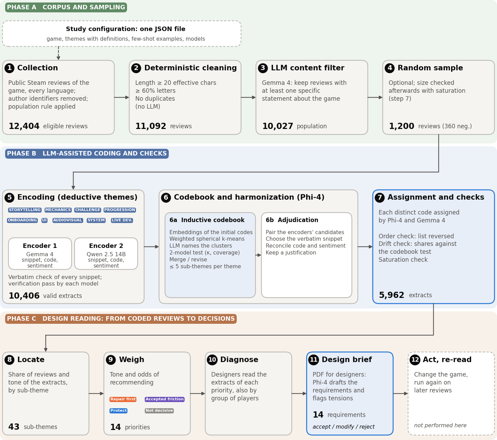
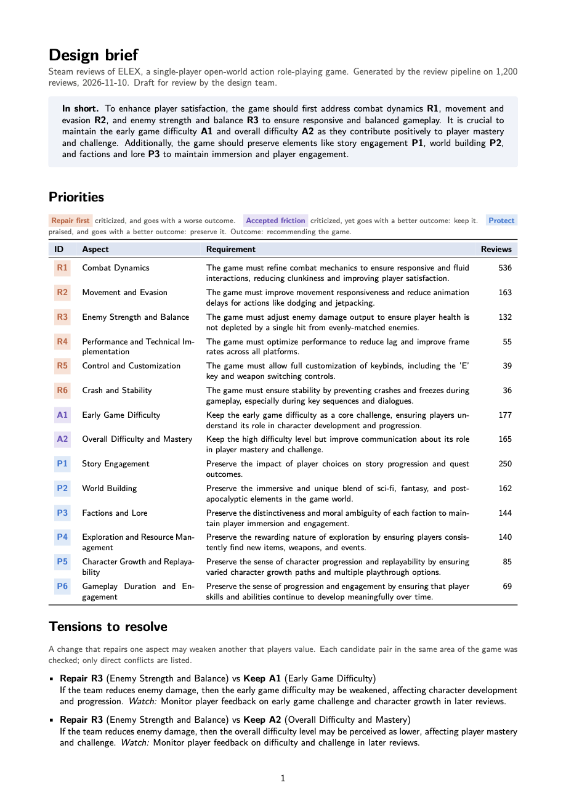
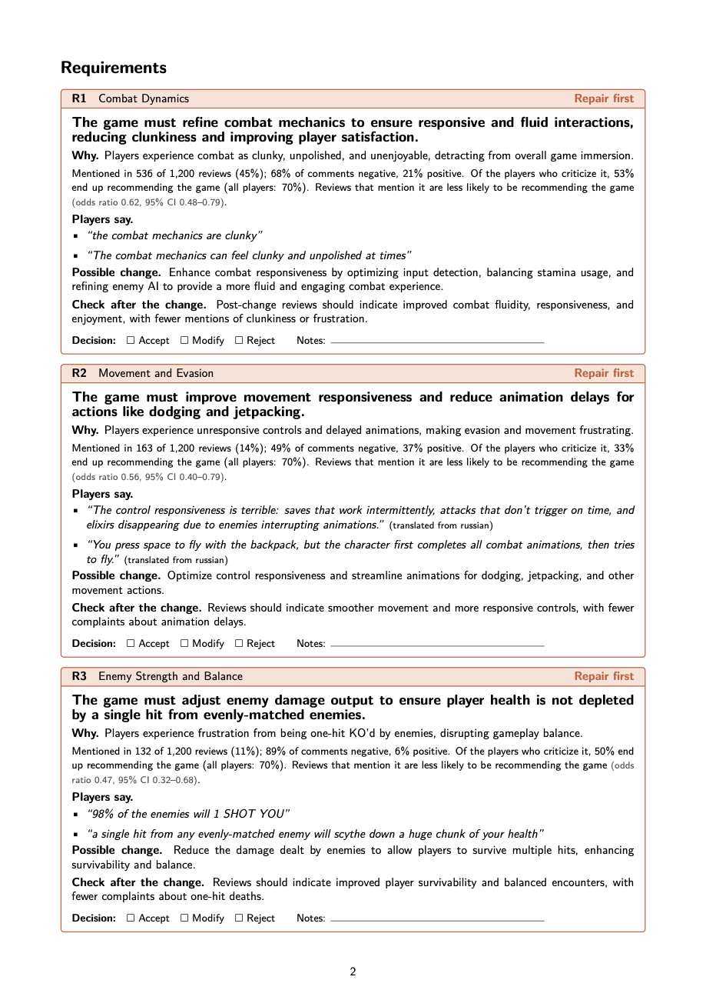

# Design practices from Steam reviews

A pipeline that turns the reviews of a game into a **design brief**: a short PDF of design requirements that a design team can
accept, modify or reject. It runs on one computer with open language models (through [Ollama](https://ollama.com)), reads reviews in
every language, and keeps every number and quote traceable to the reviews it comes from.



The pipeline has three phases:

- **A. Corpus and sampling.** Collect the public Steam reviews of a game, select the population, clean them with fixed rules, keep
  the reviews with at least one specific statement about the game, and draw a random sample.
- **B. Coding and checks.** Two models extract verbatim snippets for each of your themes, with a code and a sentiment. Sub-themes are
  induced from the data and tested by two models. A third model adjudicates. Sub-themes are then assigned again, and two checks
  test whether the order of the sub-themes or the adjudication biased them. Saturation tells you whether the sample holds the
  kinds of comments of the corpus.
- **C. Design reading.** Sub-themes are sorted, by their tone and by their association with recommending the game, into what to
  **repair**, what players **accept** despite complaining, what to **protect** and what is **not decisive**. A model drafts one
  requirement per priority and flags tensions between priorities; the script writes the PDF.

## What you get

`5_design_brief.py` writes `design_brief.pdf` ([example](examples/elex/design_brief.pdf)):

| First page | Requirement cards |
|---|---|
|  |  |

- **First page:** a three-sentence summary, the priorities with their group and number of reviews, and the tensions to resolve
  (for example, *if the team reduces enemy damage, the difficulty that players accept may be weakened*).
- **One card per requirement:** the requirement, the reason, the evidence in plain words, two quotes from players (verbatim, or
  translated and marked), a possible change, what to check in the reviews written after the change, and a box to accept, modify
  or reject it.
- **Last page:** aspects that are often criticized but not decisive, and what the brief does not show.
- **`design_brief.json`:** the source of every number and quote (review ids, original language, original text).

Numbers, quotes and layout are computed by the script; only the wording of requirements, summary and tensions comes from the
model. The requirements are drafts: they are hypotheses for a designer, not tested changes.

## Requirements

| | |
|---|---|
| Computer | One machine that can hold a model of about 10 GB in memory. We used an Apple M5 Pro with 24 GB; smaller configurations were not tested. |
| Disk | About 28 GB for the four models; under 150 MB per study |
| Software | Python 3.9 or later, [Ollama](https://ollama.com), and a LaTeX engine for the PDF ([tectonic](https://tectonic-typesetting.github.io) is the simplest; xelatex or pdflatex also work) |
| Network | Only to collect reviews and download the models. Reviews never leave the machine; there are no API fees. |
| People | Someone who can run scripts from a terminal and edit one JSON file, and a designer who knows the game to read the brief |

```bash
pip install -r requirements.txt
ollama pull gemma4
ollama pull qwen2.5:14b
ollama pull phi4
ollama pull nomic-embed-text
```

All models run with Q4_K_M quantization, temperature 0 and a fixed seed; the temperature is raised only to retry an output that is
not valid JSON. To let Ollama answer two requests at a time (faster harmonization), set `OLLAMA_NUM_PARALLEL=2` before starting it.

## Procedure

All scripts are in `pipeline/` and take `--config <file>`; paths in the configuration are relative to the configuration file. Every
step saves its progress: if it stops, run it again and it resumes.

### 1. Configure

Copy [`examples/elex/study_config.json`](examples/elex/study_config.json) next to your data and edit:

- `study.context`: one sentence that describes the game (used in every prompt);
- `themes`: what you want to know. For each theme, a definition and what it includes and excludes. Themes are the main design
  decision of a study: a team planning a patch needs different themes from one planning a sequel;
- `few_shot_examples`: a few short reviews coded correctly, ideally in more than one language and including one review with no
  relevant content;
- `models`, if you use other models.

The full list of options is in [`docs/reference.md`](docs/reference.md).

### 2. Collect and select the population

```bash
cd pipeline
python steam_collect.py --apps 411300=ELEX --out-dir ../mystudy/raw
python select_population.py ../mystudy/raw/all_reviews.json ../mystudy/data/population.json \
       --require steam_purchase --exclude received_for_free
```

The selection is optional. In our use case we kept copies bought on Steam and dropped copies declared as received for free.

### 3. Filter and sample

```bash
python 0_filtering.py --config ../mystudy/study_config.json
python stratified_sample.py --config ../mystudy/study_config.json      # writes study_config_sample.json
```

The filter removes short, non-textual and duplicate reviews with fixed rules, then keeps only reviews with a specific statement
about the game. The sample is a simple random sample (set `sampling.n_per_group`), or stratified if `sampling.group_field` is set.
See [How many reviews](#how-many-reviews) for the size.

### 4. Code

```bash
python 1_encoding.py           --config ../mystudy/study_config_sample.json
python 2_harmonization.py      --config ../mystudy/study_config_sample.json
python 3_subtheme_assignment.py --config ../mystudy/study_config_sample.json
```

`2_harmonization.py` first induces the sub-theme codebook and tests it (Cohen's κ ≥ 0.70, at most 10% unassigned codes, every
sub-theme between 5% and 40% of the codes; up to three rounds of revision), then adjudicates the proposals of the two encoders.
Read the sub-themes in `subtheme_codebook.json`: if a theme fails the test, you may widen a definition by hand and run the step again.

`3_subtheme_assignment.py` assigns the sub-theme of every distinct code again with the two evaluation models and writes
`thematic_analysis_final_reassigned.csv`, which the next steps use. Check:

- `subtheme_assignment_report.csv`: agreement between the two models on all codes;
- `subtheme_order_check.csv`: agreement between the original and the reversed order of the sub-themes (below 0.70, read the
  sub-themes of that theme with care);
- `subtheme_drift_check.csv`: shares that moved more than 10 points from the codebook test.

### 5. Check saturation

```bash
python 4_saturation.py --config ../mystudy/study_config_sample.json
```

### 6. Write the design brief

```bash
python 5_design_brief.py --config ../mystudy/study_config_sample.json
```

The outcome is a 0/1 metadata field, by default `voted_up` (recommending the game). Options go in a `design_brief` block of the
configuration: `model`, `language` (Latin-script languages), `outcome`, `outcome_label`, `alpha`, `max_extracts`, `title`.

### 7. Validate and review

- Code a subsample of reviews by hand, blind to the output, and compare (`validation.py`, see `docs/reference.md`).
- Give the PDF to a designer: every requirement must be accepted, modified or rejected.
- After a change to the game, run the pipeline again on the reviews written after it, with the same codebook, and compare the
  sub-themes named in *Check after the change*.

## Time

Measured on the use case (1,200 reviews sampled from 11,092 judged by the filter):

| Step | Scales with | Time |
|---|---|---|
| Collection | corpus | under 1 h (not logged) |
| Cleaning and filter | corpus, about 0.55 s per review | 1 h 41 |
| Encoding | sample, about 22 s per review | 7 h 16 |
| Inductive codebook | nearly fixed | 45 min |
| Harmonization | reviews with extracts, about 18 s each | about 5 h |
| Sub-theme assignment and checks | distinct codes | 1 h 26 |
| Saturation, design brief | nearly fixed | minutes |
| **Total** | | **about 16 h, unattended** |

## How many reviews

It depends on what you need. Saturation of code types (the kinds of comments) came at about 500 reviews in our use case. Weighing
the priorities needs many more, because every sub-theme is tested with a correction for multiple testing. Estimated by subsampling
the 1,200 coded reviews of the use case:

| Reviews coded | Machine time (without filter) | Priorities found, of the 14 found with 1,200 |
|---|---|---|
| 300 | 4.4 h | 1.1 |
| 500 | 6.7 h | 3.3 |
| 800 | 10.0 h | 7.5 |
| 1,200 | 14.5 h | 14 |

About 500 reviews are enough to map what players discuss; for a design brief, plan on about 1,000–1,200. These values come from one
game.

## What needs a person

The pipeline is automatic, but four choices are left to the team: the themes, the few-shot examples, a possible correction of a
sub-theme definition when the codebook test fails, and the review of every requirement of the brief. A human validation on a
subsample is recommended before relying on the results.

## Limits

- Reviews are self-selected, and players who give up early write fewer of them.
- Associations with recommending the game are not causal; the requirements are hypotheses.
- The models can drift or be biased by the order of options: read the checks before reading the shares of the sub-themes.
- The design brief is written for Latin-script languages; quotes in other scripts are shown as translations.

## Use case and data

The use case (Steam reviews of *ELEX*) and all its data, outputs and analysis scripts are in a separate repository:
[Steam reviews of ELEX: data and results](https://github.com/sbassanelli/Steam-reviews---ELEX).

## Citation

<!-- TODO: add the reference of the paper after review. -->

## License

MIT (see [LICENSE](LICENSE)).
